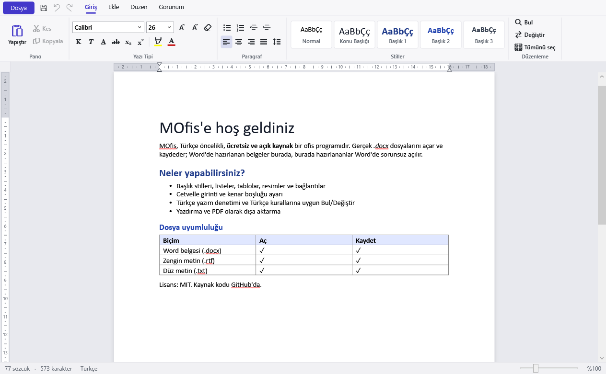

# MOfis

Ücretsiz ve açık kaynak, Türkçe öncelikli bir ofis programı. Windows için .NET 10 / WPF ile yazıldı.
Office'e alışkın biri için tanıdık bir düzen sunar; gerçek **.docx** ve **.xlsx** dosyalarını açıp kaydeder.

> *A free, open-source, Turkish-first office suite for Windows (.NET 10 / WPF). Opens and saves real .docx and .xlsx files.*



## Durum

| Uygulama | Durum |
|---|---|
| **Yazı** (kelime işlemci) | İlk sürüm hazır |
| **Hesap** (hesap tablosu) | Geliştiriliyor: temel tablo ve Türkçe formüller hazır, biçimlendirme sırada |
| Yerel yapay zekâ yardımcısı | Planlandı |

## Yazı: neler var?

- Şerit menü: Giriş, Ekle, Düzen, Görünüm
- Yazı tipi, boyut, kalın, italik, altı/üstü çizili, alt/üst simge, yazı rengi, vurgu
- Hizalama, satır aralığı, madde işaretli ve numaralı listeler (iç içe)
- Stiller: Normal, Konu Başlığı, Başlık 1-3 (Word'de de başlık olarak tanınır)
- Tablo ekleme (kareler üzerinde boyut seçimi), satır/sütun ekleme ve silme
- Resim ekleme ve panodan resim yapıştırma, bağlantılar (Ctrl+tık ile açılır)
- Yatay ve dikey cetvel: sürüklenebilir ilk satır / asılı / sol / sağ girinti işaretçileri ve kenar boşlukları
- Sayfa sonu, kenar boşlukları, yönlendirme, sayfa boyutu (A4, A5, A3, Letter, Legal)
- Bul ve Değiştir (Türkçe büyük/küçük harf kurallarıyla: i/İ, ı/I)
- Türkçe yazım denetimi (Windows'un Türkçe sözlüğüyle)
- Yazdırma ve PDF'e aktarma
- Otomatik kurtarma: program beklenmedik şekilde kapanırsa kaydedilmemiş belge geri gelir
- Desteklenmeyen öğeler (dipnot, üst bilgi vb.) içeren belgelerde açık uyarı; dosya sessizce bozulmaz

### Dosya biçimleri

- **.docx** aç / kaydet (Open XML SDK ile; çıktı resmi şema doğrulayıcısından ve Word'den geçer)
- **.rtf** ve **.txt** aç / kaydet (eski Türkçe Windows-1254 metin dosyaları dahil)

## Hesap: neler var?

- Formüller Türkçe Excel yazımıyla: `=TOPLA(A1:A5)`, `=EĞER(B2>1,5;"evet";"hayır")`, `=DÜŞEYARA(...)`
  (bağımsız değişkenler noktalı virgülle, ondalıklar virgülle ayrılır). İngilizce adlar da kabul edilir.
  Dosyaya Excel'in standart biçimiyle yazılır; Excel'de, Türkçe ya da İngilizce, aynı sonuçla açılır.
- Türkçe giriş: `1.250,5` sayı, `%18` yüzde, `21.11.2026` tarih, `250 TL` para olarak tanınır
- Formül çubuğu, ad kutusu (adrese git), sayfa sekmeleri (ekle, yeniden adlandır, taşı, sil)
- Excel tarzı klavye: oklar, Ctrl+ok (veri kenarı), Enter/Tab, F2, Delete, Ctrl+A, Ctrl+Boşluk
- Kopyala / kes / yapıştır (Excel ve diğer programlarla sekmeli metin olarak), geri al / yinele
- Otomatik toplam, seçimdeki sayıların toplamı / ortalaması durum çubuğunda
- Excel'de hazırlanmış dosyalardaki kalın/italik, renkler (tema renkleri dahil), kenarlıklar,
  birleşik hücreler, sayı biçimleri, sütun genişlikleri gösterilir
- Döngüsel başvuru ve yazım hatası olan formüller kaydedilmeden önce yakalanır
- **.xlsx** ve **.csv** aç / kaydet (CSV'de `;` / `,` / sekme ve eski Windows-1254 kodlaması otomatik algılanır)

## Klavye kısayolları

| Kısayol | İşlem |
|---|---|
| Ctrl+N / Ctrl+O / Ctrl+S / F12 | Yeni / Aç / Kaydet / Farklı kaydet |
| Ctrl+P | Yazdır |
| Ctrl+F / Ctrl+H | Bul / Değiştir |
| Ctrl+B / Ctrl+I / Ctrl+U | Kalın / İtalik / Altı çizili |
| Ctrl+= / Ctrl+Shift+= | Alt simge / Üst simge |
| Ctrl+L / Ctrl+E / Ctrl+R / Ctrl+J | Sola / Ortala / Sağa / İki yana |
| Ctrl+1 / Ctrl+5 / Ctrl+2 | Satır aralığı 1 / 1,5 / 2 |
| Ctrl+Alt+1..3 / Ctrl+Shift+N | Başlık 1-3 / Normal stil |
| Ctrl+K | Bağlantı ekle |
| Ctrl+Enter | Sayfa sonu |
| Ctrl+fare tekerleği | Yakınlaştır / uzaklaştır |

## Derleme

Gerekenler: Windows 10/11, [.NET 10 SDK](https://dotnet.microsoft.com/download/dotnet/10.0)

```powershell
dotnet build MOfis.csproj
dotnet run --project MOfis.csproj
dotnet test Tests/MOfis.Tests.csproj
```

## Kullanılan açık kaynak kütüphaneler

- [Open XML SDK](https://github.com/dotnet/Open-XML-SDK) (MIT): DOCX okuma/yazma
- [ClosedXML](https://github.com/ClosedXML/ClosedXML) (MIT): XLSX ve formüller (hesap tablosu için)

## Marka notu

MOfis bağımsız bir projedir; Microsoft ile bir ilişkisi yoktur. "Microsoft", "Word", "Excel" ve "Office"
Microsoft Corporation'ın ticari markalarıdır. MOfis yalnızca bu programların dosya biçimleriyle uyumludur.

## Lisans

[MIT](LICENSE) © 2026 SingleKnight
